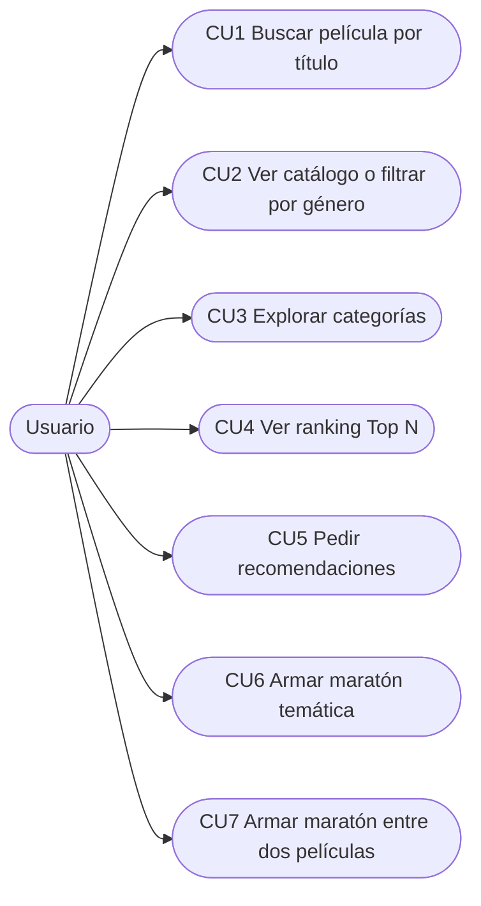

# Casos de uso — Cinapsis

## Diagrama de casos de uso

El único actor es el **Usuario** (una persona que quiere decidir qué película ver). Todos los casos de uso se inician desde el menú principal de la terminal.

---

## CU1 — Buscar película por título

| Campo | Descripción |
|---|---|
| **Actor** | Usuario |
| **Estructura usada** | AVL ordenado por título |
| **Precondición** | El catálogo fue cargado al iniciar el programa. |
| **Flujo principal** | 1. El usuario elige la opción 1 del menú. 2. El sistema pide el título a buscar. 3. El usuario escribe el título. 4. El sistema busca en el AVL y muestra la película con su género, año, rating y estado. |
| **Flujo alternativo** | 4a. Si el título no existe, el sistema muestra "Película no encontrada." y vuelve al menú. |

## CU2 — Ver catálogo o filtrar por género

| Campo | Descripción |
|---|---|
| **Actor** | Usuario |
| **Precondición** | El catálogo fue cargado al iniciar el programa. |
| **Flujo principal** | 1. El usuario elige la opción 2 (catálogo completo) o la 3 (filtrar por género). 2. En la opción 2, el sistema lista todas las películas numeradas. 3. En la opción 3, el sistema pide un género y muestra las películas que lo contienen. |
| **Flujo alternativo** | 3a. Si ninguna película coincide con el género, el sistema muestra "No hay películas de ese género." |

## CU3 — Explorar categorías

| Campo | Descripción |
|---|---|
| **Actor** | Usuario |
| **Estructura usada** | Árbol general (Películas → Género → Película) |
| **Precondición** | El catálogo fue cargado y el árbol de categorías fue construido. |
| **Flujo principal** | 1. El usuario elige la opción 4. 2. El sistema muestra las categorías (géneros) disponibles. 3. El usuario escribe el nombre de una categoría. 4. El sistema muestra las películas que cuelgan de esa categoría. |
| **Flujo alternativo** | 4a. Si la categoría no existe, el sistema muestra "Categoría no encontrada." 4b. Si la categoría no tiene películas, el sistema lo informa. |

## CU4 — Ver ranking Top N

| Campo | Descripción |
|---|---|
| **Actor** | Usuario |
| **Estructura usada** | Max-Heap (clave: rating, con el año como desempate) |
| **Precondición** | El catálogo fue cargado y el heap fue construido. |
| **Flujo principal** | 1. El usuario elige la opción 5. 2. El sistema pregunta cuántas películas quiere ver. 3. El usuario ingresa un número N. 4. El sistema extrae las N mejores sin alterar el ranking original y las muestra ordenadas con su rating. |
| **Flujo alternativo** | 3a. Si el valor no es un entero, el sistema muestra "Tenés que ingresar un número entero." 3b. Si N es 0 o negativo, el sistema muestra "Ingresá un número mayor a 0." 4a. Si N supera la cantidad de películas, se muestran todas. |

## CU5 — Pedir recomendaciones

| Campo | Descripción |
|---|---|
| **Actor** | Usuario |
| **Estructura usada** | Grafo de similitud + BFS (hasta 2 saltos) |
| **Precondición** | El catálogo fue cargado y el grafo fue construido. |
| **Flujo principal** | 1. El usuario elige la opción 6. 2. El sistema pregunta qué película le gustó. 3. El usuario escribe el título. 4. El sistema recorre el grafo en anchura desde esa película y muestra las similares: las de 1 salto como "Muy similar" y las de 2 saltos como "También te puede gustar". |
| **Flujo alternativo** | 4a. Si la película no existe o no tiene películas conectadas, el sistema lo informa y vuelve al menú. |

## CU6 — Armar maratón temática

| Campo | Descripción |
|---|---|
| **Actor** | Usuario |
| **Estructura usada** | Grafo de similitud + DFS |
| **Precondición** | El catálogo fue cargado y el grafo fue construido. |
| **Flujo principal** | 1. El usuario elige la opción 7. 2. El sistema pregunta con qué película quiere arrancar y cuántas quiere incluir. 3. El usuario responde ambos datos. 4. El sistema recorre el grafo en profundidad desde esa película y muestra la maratón con las primeras N películas, indicando película inicial y tema predominante. |
| **Flujo alternativo** | 3a. Si la cantidad no es un entero positivo, el sistema muestra el error correspondiente. 4a. Si la película inicial no existe, el sistema muestra "No encontramos esa película en el catálogo." |

## CU7 — Armar maratón entre dos películas

| Campo | Descripción |
|---|---|
| **Actor** | Usuario |
| **Estructura usada** | Grafo de similitud + Dijkstra (camino mínimo) |
| **Precondición** | El catálogo fue cargado y el grafo fue construido. |
| **Flujo principal** | 1. El usuario elige la opción 8. 2. El sistema pregunta la película de origen y la de destino. 3. El usuario escribe ambos títulos. 4. El sistema calcula el camino de menor costo (mayor afinidad total) y muestra la maratón: películas conectadas, afinidad total y recorrido recomendado. |
| **Flujo alternativo** | 4a. Si alguna de las películas no existe o no hay camino entre ellas, el sistema muestra "No encontramos una maratón óptima entre esas dos películas." |
