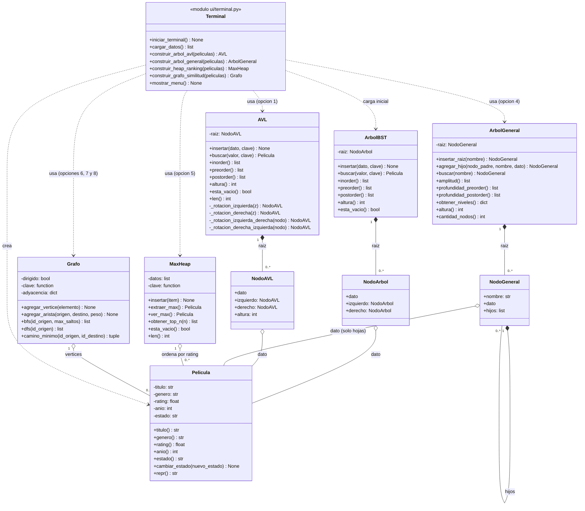

# Diagrama de clases

> Actualizado en TP10 con la implementación completa (v1 + AVL, árbol general, heap y grafo).

## Cómo leer las relaciones

- **Composición (`*--`):** el nodo no existe fuera de su árbol. Si se destruye el árbol, se destruyen sus nodos (`AVL` → `NodoAVL`, `ArbolGeneral` → `NodoGeneral`, etc.).
- **Agregación (`o--`):** las estructuras *contienen referencias* a objetos `Pelicula`, pero las películas existen independientemente de ellas: la misma `Pelicula` está a la vez en el AVL, en el árbol general, en el heap y en el grafo, sin duplicarse.
- **Dependencia (`..>`):** `Terminal` construye y usa las estructuras, pero no forma parte de ellas. La estructura no conoce a la terminal.
- **Herencia:** no se usa. Cada estructura es independiente; el criterio de orden se le pasa como función (`clave`), lo que permite reutilizar las mismas clases con cualquier tipo de dato.
