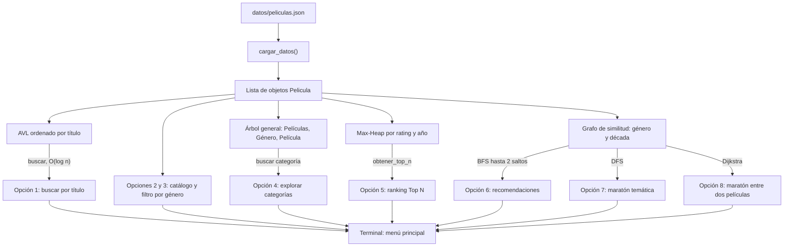

# Diagrama de conexión de estructuras

Muestra cómo fluyen los datos: desde el archivo JSON hasta cada opción del menú, pasando por la estructura y el algoritmo que resuelve cada consulta.

## Qué estructura resuelve qué

| Opción | Estructura | Algoritmo | Complejidad | Por qué esta estructura |
|---|---|---|---|---|
| 1. Buscar por título | AVL | Búsqueda binaria en árbol | O(log n) | Se busca mucho por una clave ordenable. El AVL garantiza O(log n) aun con datos cargados en orden, donde un BST común degenera en O(n). |
| 2. Ver catálogo | Lista | Recorrido | O(n) | Solo se muestra todo, no hace falta estructura especial. |
| 3. Filtrar por género | Lista | Recorrido | O(n) | El filtro mira todas las películas. |
| 4. Explorar categorías | Árbol general | Búsqueda en el árbol | O(n) en el peor caso | Los géneros son una jerarquía natural (un género tiene muchas películas), que un árbol binario no puede representar. |
| 5. Ranking Top N | Max-Heap | `obtener_top_n` (copia + N extracciones) | O(n + N log n) | El heap entrega siempre el mejor elemento sin ordenar todo el catálogo. |
| 6. Recomendaciones | Grafo | BFS limitado a 2 saltos | O(V + E) | BFS recorre por niveles: primero los más parecidos (1 salto) y después los menos (2 saltos). |
| 7. Maratón temática | Grafo | DFS | O(V + E) | DFS encadena películas siguiendo una línea de similitud. |
| 8. Maratón entre dos películas | Grafo | Dijkstra | O(V²) | Las aristas tienen peso (afinidad); Dijkstra encuentra el recorrido de menor costo total. |

## Cómo se construyen las estructuras al iniciar

| Estructura | Criterio | Costo de construcción |
|---|---|---|
| AVL | Se inserta cada película usando el título en minúsculas como clave. | O(n log n) |
| Árbol general | Raíz "Películas"; un hijo por cada género; cada película cuelga de su género. | O(n) |
| Max-Heap | Se inserta cada película con clave `(rating, año)`: ante igual rating, gana la más reciente. | O(n log n) |
| Grafo de similitud | Se comparan todos los pares de películas según la tabla de abajo. | O(n²) |

### Pesos del grafo de similitud

Un **peso menor significa mayor afinidad**, por eso Dijkstra (que minimiza el costo) devuelve el recorrido más afín.

| Relación entre dos películas | Peso de la arista |
|---|---|
| Mismo género **y** misma década | 1 |
| Mismo género, distinta década | 2 |
| Misma década, distinto género | 3 |
| Ni género ni década en común | Sin arista |

## Observaciones de diseño

- Una misma `Pelicula` es compartida por referencia entre las cuatro estructuras: no se duplican los datos, solo se duplica la forma de acceder a ellos.
- Cada estructura recibe el criterio de orden como función (`clave`), de modo que están desacopladas del dominio y podrían reutilizarse con otro tipo de dato.
- La construcción del grafo es la operación más costosa (O(n²) comparaciones). Es el punto a revisar si el catálogo creciera mucho.
